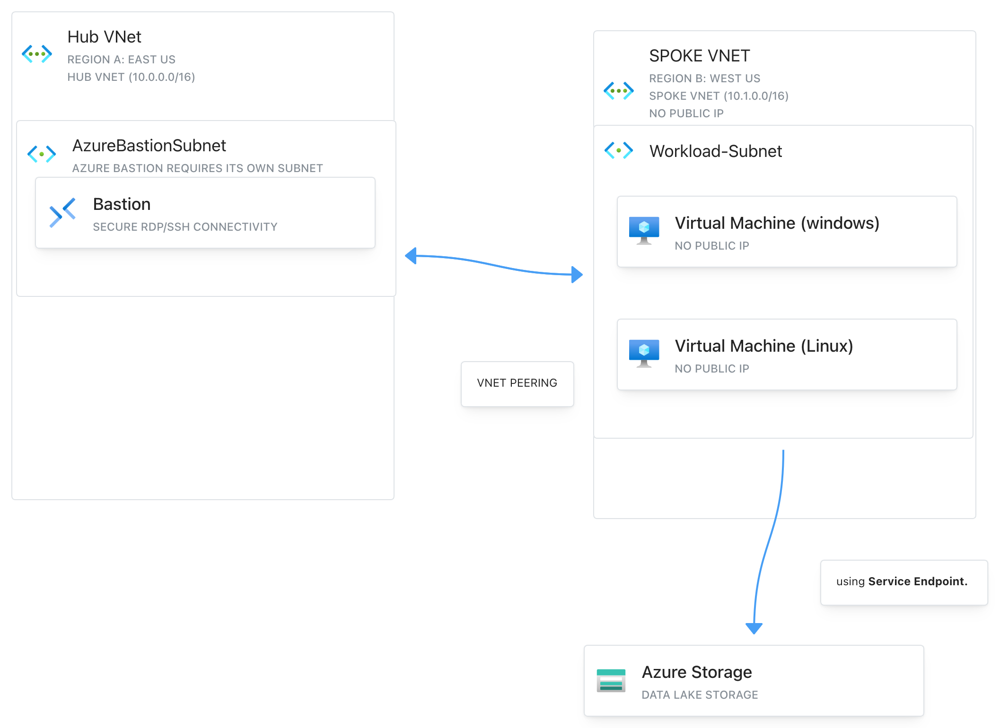
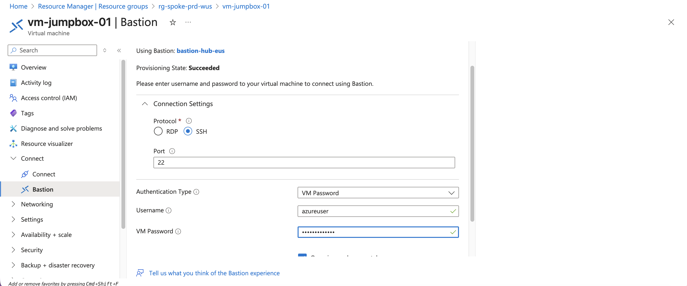
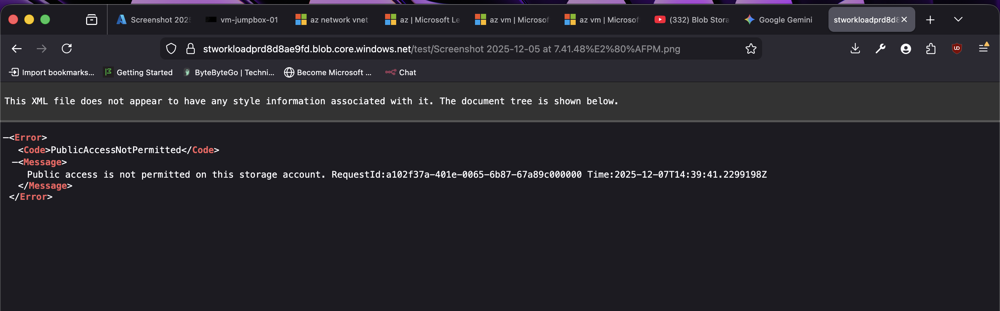

# Lab 01: Azure Enterprise Hub-and-Spoke Network

This lab documents the end-to-end process of designing and deploying a secure, multi-region Azure Hub-and-Spoke network from scratch.

**Author:** Hashir Owais
**Blog Series:** [Part 1](https://blog.hashirowais.com/posts/azure-enterprise-hub-and-spoke-network-implementation/), [Part 2](https://blog.hashirowais.com/posts/azure-enterprise-hub-and-spoke-network-implementation---part-2/), [Part 3](https://blog.hashirowais.com/posts/azure-enterprise-hub-and-spoke-network-implementation---part-3/), [Part 4](https://blog.hashirowais.com/posts/azure-enterprise-hub-and-spoke-network-implementation---part-4/), [Part 5](https://blog.hashirowais.com/posts/azure-enterprise-hub-and-spoke-network-implementation---part-5/)

---

## Architecture Overview

The Hub-and-Spoke network topology provides a central point (the "Hub") for managing connectivity, security, and logging, while isolating individual workloads in their own virtual networks (the "Spokes"). This lab implements this architecture across two Azure regions.

*(Image Placeholder: `hub-and-spoke-architecture.png`)*

---

## Phase 1: Identity & Governance

*   **Goal:** Establish a solid Identity and Governance foundation.
*   **Actions:**
    *   Configured resource groups (`rg-hub-prd-eus`, `rg-spoke-prd-wus`).
    *   Set up Entra ID users and groups (`group-adadmin`, `group-subadmin`, `group-devs`).
    *   Applied the principle of least privilege using Role-Based Access Control (RBAC) roles.
    *   Secured the Hub resource group with a `CanNotDelete` management lock.

---

## Phase 2: Network Infrastructure (The Backbone)

*   **Goal:** Build the secure network backbone.
*   **Actions:**
    *   Provisioned VNets in separate regions (`vnet-hub-eastus`, `vnet-spoke-westus`).
    *   Connected the VNets using Global VNet Peering.
    *   Deployed a Private DNS Zone (`corp.internal`) and linked it to both VNets for seamless internal name resolution.

---

## Phase 3: Compute & Secure Access

*   **Goal:** Populate the network with compute resources and establish a secure access path.
*   **Actions:**
    *   Created a dedicated subnet (`AzureBastionSubnet`) for Azure Bastion.
    *   Deployed Azure Bastion into the Hub VNet for secure, browser-based RDP/SSH access.
    *   Provisioned a management "jumpbox" VM (`vm-jumpbox-01`) and a workload VM (`vm-workload-01`), both without public IP addresses.
    *   Validated the entire setup by connecting securely from the public internet to the isolated Spoke VM via the Hub's Bastion service.

*(Image Placeholder: `bastion-connection.png` - A screenshot showing the Bastion connection UI)*

---

## Phase 4: Storage Security Hardening

*   **Goal:** Secure data at rest by isolating a storage account from the public internet.
*   **Actions:**
    *   Provisioned an Azure Storage Account.
    *   Configured the storage account's firewall to deny all public traffic by default.
    *   Enabled a `Microsoft.Storage` Service Endpoint on the Spoke VNet's subnet.
    *   Added a specific firewall rule to the storage account to only allow access from the trusted Spoke subnet.
    *   Validated that access from the public internet was blocked (403 Forbidden) while access from the Spoke VM was successful.

*(Image Placeholder: `storage-firewall.png` - A screenshot showing the storage account's firewall settings)*

---

## Phase 5: Observability & Operations

*   **Goal:** Implement monitoring and alerting to maintain operational awareness.
*   **Actions:**
    *   Deployed a central Log Analytics Workspace in the Hub.
    *   Configured diagnostic settings for NSGs, Bastion, and the Storage Account to forward all logs and metrics to the central workspace.
    *   Created an Azure Monitor alert to trigger an email notification if the workload VM's CPU exceeds 90% for 5 minutes.
    *   Verified NSG rules using manual SSH tests, which would be supplemented with Network Watcher's IP Flow Verify tool in a real-world scenario.

---

## Conclusion

This lab successfully demonstrates the end-to-end creation of an enterprise-grade Hub-and-Spoke network in Azure. By layering security, centralizing management, and building robust observability, this architecture provides a scalable and secure foundation for any cloud deployment.